<!-- ============================================================
     HOW THIS README IS BUILT
     - Header = a code block, not a generic "Hi I'm X" banner.
       It says who Mohammad is in the language he actually writes.
     - Navy (#0d1b2e) + gold (#d4af37) = the same palette as his
       LinkedIn banner, so GitHub and LinkedIn look like one brand.
     - Private repos are NEVER linked. They are shown as 🔒 Private
       with a short description only — a private link is a dead link
       for every visitor.
     - No invented stats, dates, or claims anywhere.
     ============================================================ -->

<div align="center">

<!-- Optional typing line (third-party service readme-typing-svg).
     Delete these 3 lines if you don't want an external dependency. -->


</div>

```js
const mohammad = {
  name: "Mohammad Hasan Akhtari Ghalati",
  location: "Shiraz, Fars, Iran",
  student: "Computer Science & Software Engineering — Payame Noor University",
  roles: [
    "Developer",
    "Founder @ Pimox — network services",
    "Owner @ Babak Optic — optical retail, Shiraz",
  ],
  stack: ["JavaScript", "TypeScript", "Node.js", "Express", "React", "MongoDB"],
  also: ["Python", "Electron", "discord.js", "Telegram Bots", "FFmpeg"],
  builds: "real tools for real shops, servers & communities — not demos",
  openTo: ["freelance projects", "collaboration", "Discord bots", "business software"],
};

console.log(`Hello, world — I'm ${mohammad.name.split(" ")[0]}.`);
```

<div align="center">

### I learn by shipping. Most of what I know comes from software people actually use.

I run two businesses in Shiraz — **Pimox** (independent network services) and an
independent optical store — while studying Computer Science. My main project,
**OpticLedger**, grew out of my own shop counter: offline-first accounting & inventory
for optical retail, with a real Express + MongoDB backend, not a toy CRUD app.

</div>

---

## 🛠️ Stack

<div align="center">


</div>


---

## 🚀 Featured Projects

> Order is deliberate: the business software first, the Discord/Harmony work last.
> 🔒 = private repository — no link on purpose. Public repos link to the real repo.

| # | Project | What it is | Stack |
|---|---------|------------|-------|
| 1 | **OpticLedger** 🔒 | Offline-first accounting & inventory for optical shops. Frames & lenses tracked by supplier, live balance owed to my father's shop, passwordless email-OTP sign-in with roles, two Telegram bots (security alerts + financial reports), Jalali-date Excel export & invoices, bidirectional offline sync. | TypeScript · Express · MongoDB · React 19 · Telegram Bots |
| 2 | **Audio-Peak Highlight Clipper** | Desktop app that finds the loudest moments in a media file and cuts highlight clips automatically. | Electron · Node.js · React · FFmpeg (AMD AMF) |
| 3 | **Spimmd** 🔒 `v1.0.8` | Desktop music player for Windows — multilingual UI, auto-updates, proper NSIS installer. | Electron · React 18 · Vite · Zustand · i18next |
| 4 | **Map-Tracker** 🔒 | Find locations and export them to Excel — a Telegram bot plus an interactive web map. | node-telegram-bot-api · React 19 · Leaflet · ExcelJS |
| 5 | **AR Virtual Try-On** — Telegram Mini-App | Try on eyewear virtually from your phone. Face tracking + 3D frames. | MediaPipe Face Mesh · Three.js · Telegram Mini Apps |
| 6 | **Harmony** 🔒 | Discord bot for a real community server — voice, music, scheduled tasks, Jalali calendar. | discord.js 14 · @discordjs/voice · MongoDB · Mongoose |
| 7 | [**radio-harmony**](https://github.com/Mhmd-Akh/radio-harmony) ⭐ 5 | Open-source library that streams Spotify, SoundCloud, YouTube & MP3 links into a Discord voice channel. Born from Harmony. | JavaScript · Node.js · discord.js |
| 8 | [**FiveM-Harmony**](https://github.com/Mhmd-Akh/FiveM-Harmony) | TypeScript library for FiveM server status & API data. | TypeScript · Axios |

<details>
<summary><b>More on GitHub →</b></summary>

<br>

- **Harmony-Logger-Public** — public logger companion to Harmony (work in progress).
- **Public-bot-genesis** — an earlier public Discord bot codebase (2022).
- Everything above that is private stays private — screenshots / demo on request.

</details>

---

## 📊 GitHub Stats

> These cards are **live embeds** — they render automatically once this README is published,
> and they only ever show *public* activity. No numbers are typed in by hand here.

<div align="center">


</div>

---

## 🐍 Contribution Snake

<picture>
  <source media="(prefers-color-scheme: dark)" srcset="https://raw.githubusercontent.com/Mhmd-Akh/Mhmd-Akh/output/github-contribution-grid-snake-dark.svg">
  <source media="(prefers-color-scheme: light)" srcset="https://raw.githubusercontent.com/Mhmd-Akh/Mhmd-Akh/output/github-contribution-grid-snake.svg">
  
</picture>

---

## 👾 Pac-Man

<picture>
  <source media="(prefers-color-scheme: dark)" srcset="https://raw.githubusercontent.com/Mhmd-Akh/Mhmd-Akh/output/pacman-contribution-graph-dark.svg">
  <source media="(prefers-color-scheme: light)" srcset="https://raw.githubusercontent.com/Mhmd-Akh/Mhmd-Akh/output/pacman-contribution-graph.svg">
  
</picture>

---

## 💼 What I do besides code

```
$ whoami
> developer in Shiraz — building between the shop counter and the server

$ ls ./business
> Pimox/          independent network services — WireGuard / WGDashboard
> Babak-Optic/    optical retail — frames, lenses, supplier billing
```

- **Pimox** — my own network services business: subscriptions, setup, support, renewals.
- **Babak Optic** — my own optical store; the reason OpticLedger exists at all.

---

## 📫 Reach me

<div align="center">

[](mailto:mmdphantasm@gmail.com)
[](https://www.linkedin.com/in/mhmdakhtari)
[](https://github.com/Mhmd-Akh)

📍 Shiraz, Iran · 💬 Persian & English · 🤝 Open to freelance & collaboration

</div>

---

<div align="center">

```text
// built by hand, in Shiraz — between customers, code, and classes.
```

</div>


